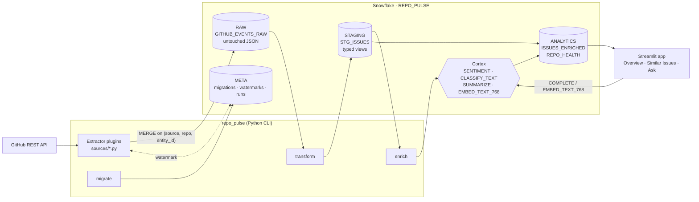

# repo-pulse

**GitHub engineering intelligence on Snowflake.** repo-pulse pulls issues (and, later, PRs,
commits and releases) from the GitHub API into Snowflake, keeps an untouched raw copy, shapes it
into typed staging tables, and uses Snowflake Cortex to score sentiment, classify, summarise and
embed every issue — all inside the warehouse, no data leaves. A small Streamlit app then answers
questions like *which repo is heating up*, *have we seen this bug before*, and *what are users
complaining about this month*. It is a personal/portfolio-scale project: one XSMALL warehouse,
a handful of repos, and a cost profile measured in cents per day.

## Architecture



Layers are strict: **RAW** is never transformed, **STAGING** is typed and cleaned, **ANALYTICS**
is enriched and business-facing. Every schema change is a numbered migration; every transform is
an idempotent single-model SQL file. See [CLAUDE.md](CLAUDE.md) for the full conventions.

## Setup

Follow [SETUP.md](SETUP.md) — it covers the Snowflake trial and role/user creation, the GitHub
token, key-pair auth, `.env`, and sanity checks. Once that is done:

```bash
make check                     # env, key file, connection, Cortex access: PASS/FAIL per item
make all                       # migrate -> ingest -> transform -> enrich
make app                       # http://localhost:8501
```

`make all` runs the four steps in one process and stops at the first failure with a non-zero
exit code. Individual steps: `make migrate`, `make ingest [SOURCE=github_issues]`,
`make transform`, `make enrich`. Every step is safe to rerun. `make test` runs the unit tests;
nothing in them talks to Snowflake or GitHub.

## Cost notes

- **Warehouse**: `REPO_PULSE_WH` is XSMALL with `AUTO_SUSPEND = 60`. A full `make all` on a
  few thousand issues runs for a couple of minutes; at ~1 credit/hour that is well under
  0.1 credit per run. Idle cost is zero.
- **Cortex functions** are billed per million tokens and dominate the bill. Per issue, enrichment
  makes one `SENTIMENT`, one `CLASSIFY_TEXT`, one `EMBED_TEXT_768` call, plus one `SUMMARIZE`
  only when the body exceeds 300 characters. Issues are enriched **once** and re-enriched only
  when their `updated_at` moves, so steady-state cost tracks new/edited issues, not total volume.
  Bodies are capped at 4000 characters in staging and 2000 for embedding.
- **The app**: queries are cached for 10 minutes (`st.cache_data(ttl=600)`). *Similar Issues*
  makes one `EMBED_TEXT_768` call per search; *Ask* makes one `COMPLETE` call per question with
  ~30 issues of context. Pick a cheaper `cortex.complete_model` in `config.yaml` if this matters.
- **Limits** in `config.yaml` (`limits.github_issues`) cap rows per repo per run — lower them on
  first runs against big repos.
- The GitHub API is free; the extractor sleeps until the rate-limit reset rather than failing.

## How to extend

**Add a source** — create `repo_pulse/sources/github_pulls.py` with a class that subclasses
`Extractor`, sets `name = "github_pulls"`, and implements `extract(repo, since)` yielding
`{"entity_id", "updated_at", "payload"}` dicts with the API object untouched in `payload`.
Subclassing registers it; `make ingest SOURCE=github_pulls` works with no change to
`pipeline.py`. Add a per-source limit under `limits:` in `config.yaml`. It lands in the same
`RAW.GITHUB_EVENTS_RAW` table, keyed by `source`.

**Add a migration** — add `migrations/V005__short_name.sql` (next number, `IF NOT EXISTS`
everywhere, one concern per file) and run `make migrate`. Applied migrations are immutable:
their checksum is recorded and a modified file fails loudly. Never edit one — add another.

**Add a transform** — add one `CREATE OR REPLACE VIEW|TABLE … AS SELECT …` per file under
`transforms/`. Prefix by layer: `stg_*` runs first, then `int_*`, then everything else
(`analytics_*`, `mart_*`); within a layer, alphabetical. No procedural SQL — these become dbt
models. Filter raw rows with `WHERE source = '<name>'`.

**Add a page** — add `app/pages/4_My_Page.py`. Start with `from common import conn, select_repo`
for the shared connection and sidebar repo picker, and put every query in `app/queries.py` as
a `@st.cache_data(ttl=600)` function taking `_conn` plus bind parameters written with `?`.
Pages never contain SQL, so the app moves to Streamlit in Snowflake unchanged.

See [ROADMAP.md](ROADMAP.md) for what is planned.
